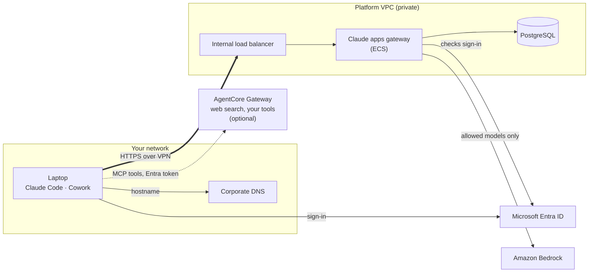
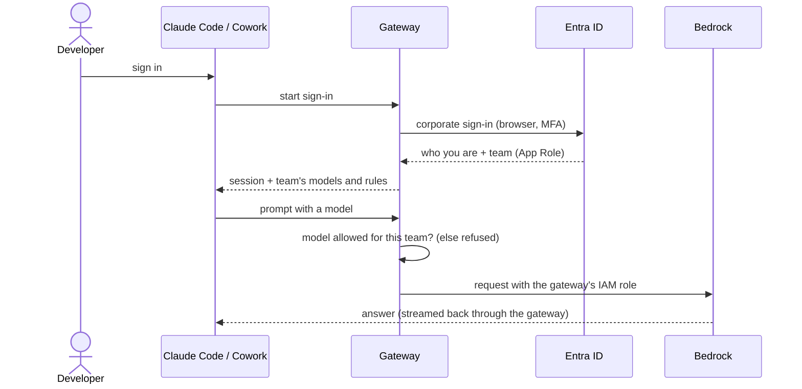

# Claude Code and Cowork on Amazon Bedrock

This use case lets an organization give its employees **Claude Code** (in the
terminal and IDEs) and **Claude Desktop with Cowork**, with every AI request
served by **Amazon Bedrock in the organization's own AWS account**.

It deploys Anthropic's [Claude apps gateway](https://code.claude.com/docs/en/claude-apps-gateway)
on the EBA platform's private network. The gateway sits between the Claude apps
and Bedrock:

- **Sign-in with Microsoft Entra ID.** Employees use their corporate account,
  with your MFA and Conditional Access. Disabling the account removes access
  within an hour.
- **Models per team.** Each team (an Entra App Role) gets only the models you
  allow. The gateway enforces this on every request.
- **No credentials on laptops.** The gateway calls Bedrock with its own IAM
  role. Employees never get AWS keys or API keys.
- **Private.** The gateway is reachable only from your corporate network
  (VPN or Direct Connect), never from the internet.

The platform or cloud team deploys and runs it. Employees only sign in.

## Foundation for the Agentic AI platform

This use case is also the first layer of the EBA Agentic AI platform. Claude
Code and Cowork become the apps employees use, and the platform underneath
adds the AgentCore components:

| AgentCore component | Role with Claude Code and Cowork | With this use case |
|---|---|---|
| Networking (platform VPC) | The Claude apps gateway runs in it, next to the AgentCore runtimes | Always |
| AgentCore Gateway | One place for MCP tools, including the managed web search | With `agentcore_tools`: Claude Code and Cowork get its tools, signed in with Entra |
| AgentCore Identity | Sign-in to tools on behalf of the user | Platform component |

With `agentcore_tools`, the gateway hands each team's Claude Code and Cowork
the AgentCore Gateway as an MCP server named **agentcore**. 

## How it works



A laptop reaches the gateway over your private network and signs in with
Entra ID. The gateway checks which team the person is in and forwards only
requests for that team's models to Bedrock.

### What gets deployed

| Part | Notes |
|---|---|
| Internal load balancer, HTTPS only | Reachable only from your corporate ranges, never from the internet |
| Claude apps gateway, 2 tasks on ECS Fargate | Updates roll over without downtime |
| PostgreSQL (RDS), encrypted | Sign-in state and spend counters |
| Container image | Built from the pinned Claude Code release after its signature is verified |
| IAM role | Allows exactly the Bedrock models in your catalog |
| Health probe | What `verify.py` uses to check the gateway from inside the VPC |

### Sign-in and a request



Sign-in and every request go through the gateway, which enforces each team's
model list on the server, so a modified client can't bypass it.

## What's in this folder

| File | For | What |
|---|---|---|
| **README.md** | everyone | This page: start here |
| [docs/walkthrough.md](docs/walkthrough.md) | your network, DNS, Entra and MDM teams | Their setup tasks, step by step |
| [docs/changes.md](docs/changes.md) | whoever runs the platform | Add models and teams, upgrade, rotate the secret |
| [docs/platform.example.yaml](docs/platform.example.yaml) | whoever deploys | A complete `platform.yaml` to copy and fill in, instead of the wizard |
| `setup.py` | whoever deploys | The setup wizard |
| `verify.py` | whoever deploys | Checks the deployed gateway |
| `manifest.yaml`, `stack.py`, `gateway/` | the platform | Implementation; you don't need to open these |

## Quick start

### 1. Prepare with your teams

Your network, DNS, PKI and Entra administrators each have a short task:
connect the corporate network to the platform VPC, pick a hostname, get a
certificate, and register an Entra application with one App Role per team.
Follow **[Set up the network, Entra ID and devices](docs/walkthrough.md)**.

You need from them: the hostname, the certificate in ACM, the Entra tenant
ID, application ID and client secret, the App Role names, and the corporate
network ranges.

### 2. Configure with the wizard

From the repository root, signed in to the AWS account you deploy to:

```bash
aws sso login --profile <your-profile>
export AWS_PROFILE=<your-profile>
./scripts/deploy.sh design --profile greenfield     # only if you have no platform.yaml yet
.venv/bin/python use-cases/claude-3p-on-bedrock/setup.py
```

The wizard asks for each value, stores the Entra client secret in Secrets
Manager, lets you pick models and teams, and writes `platform.yaml`. It asks
before it creates or changes anything, and ends with a check that must show
no FAIL.

To write the file by hand instead, copy the example and replace every value
marked `CHANGE`:

```bash
cp use-cases/claude-3p-on-bedrock/docs/platform.example.yaml platform.yaml
```

Then store the Entra client secret yourself, as in
[Prepare the AWS account](docs/walkthrough.md#prepare-the-aws-account).

### 3. Deploy

```bash
./scripts/deploy.sh design
./scripts/deploy.sh doctor
NON_INTERACTIVE=1 ./scripts/deploy.sh deploy --stack "agentcore-workshop-dev-networking agentcore-workshop-dev-uc-claude-3p-on-bedrock"
```

About 25 minutes the first time. This deploys only the platform network and
the Claude apps gateway. Replace `agentcore-workshop-dev` if you changed
`project` or `environment`. To deploy the whole platform too, use
`./scripts/deploy.sh build`.

**With `agentcore_tools`** (the example file has it), the AgentCore Gateway has
to exist first, because the use case reads its URL when it deploys. Add the
platform's `auth` and `gateway` stacks to the list. The use case's stack also
declares the dependency, so the gateway always deploys first:

```bash
NON_INTERACTIVE=1 ./scripts/deploy.sh deploy --stack "agentcore-workshop-dev-networking agentcore-workshop-dev-auth agentcore-workshop-dev-gateway agentcore-workshop-dev-uc-claude-3p-on-bedrock"
```

If the deployment has no gateway stack, the synth (part of `deploy` and `build`)
stops with an error that says so. Remove `agentcore_tools` to deploy without it.

### 4. Check it works

```bash
.venv/bin/python use-cases/claude-3p-on-bedrock/verify.py
```

Expect `OK: https://<hostname> healthz/readyz 200, OAuth metadata issuer matches`.
If it says FAIL:

| FAIL on | Look at |
|---|---|
| `readyz` | The gateway can't reach its database: the task logs in `/<project>/<env>/use-cases/claude-3p-on-bedrock` |
| `oauth_metadata` | The gateway didn't finish starting, usually the Entra tenant ID or a rejected setting. The task logs name the field. |
| connection or DNS error | The load balancer isn't healthy yet: wait a few minutes and run it again |

### 5. Connect laptops

Add the DNS record, push two small settings to laptops with MDM, and test
with one pilot user per team. See
[Connect laptops](docs/walkthrough.md#connect-laptops) and
[Test with pilot users](docs/walkthrough.md#test-with-pilot-users).

## Change models, teams and settings

Adding a model, adding a team, offboarding someone, upgrading Claude Code:
see **[Change models, teams and settings](docs/changes.md)**. Most changes are a
`platform.yaml` edit and a 4-minute deploy.

## Known limitations

- **Fixed platform network.** The platform VPC is `10.0.0.0/16`. Your
  corporate ranges must not overlap it. See
  [Connect the corporate network](docs/walkthrough.md#connect-the-corporate-network).
- **IPv4 only, and not too wide.** `client_cidrs` accepts IPv4 ranges only,
  because sign-in breaks behind an internal dual-stack load balancer, and
  refuses ranges wider than `/8` such as `0.0.0.0/0`, which would admit every
  network routed into the VPC.
- **Access ends within one session.** A person you remove in Entra keeps
  access until their session expires: `session_ttl_hours`, 1 hour by default.
- **Duplicate models in Claude Desktop.** Models with a 1M-token context show
  twice. See [Show each model only once](docs/changes.md#show-each-model-only-once-in-claude-desktop).
- **Outside the platform's Bedrock controls.** The platform's model allow-list
  (`agents.allowed_models`) and guardrailed-only inference
  (`security.require_guardrails`, [control 6b](../../docs/SECURITY_CONTROLS.md))
  are enforced on the AgentCore runtime roles. This use case's gateway has its
  own role: it can invoke every model in `models:`, and uses a guardrail only if
  you set `guardrail:`. Keep `models:` to your approved list, and set `guardrail:`
  where your policy requires guardrailed inference. Nothing checks this for you yet.
- **AgentCore Gateway over the internet.** With `agentcore_tools`, laptops
  reach the AgentCore Gateway at its public AWS address over HTTPS, and only
  a valid Entra token gets through. A private-only path would need a resource
  policy that limits the gateway to the platform's VPC endpoint, plus corporate
  DNS that forwards the gateway's name into the VPC. This use case doesn't set
  that up.
- **Claude Code AgentCore sign-in through the gateway untested.** Cowork was
  tested end to end. Claude Code gets the same server from the gateway (it
  needs Claude Code 2.1.259 or later); test it with a pilot user.

## Before production

- `retain: true` and `database.multi_az: true`, so the database survives
  stack changes and one Availability Zone failing.
- `gateway_ip_allowlist: true`, so the gateway also checks client ranges itself.
- A Bedrock `guardrail` with a published version.
- Copy the two public container images (the gateway base image and the
  busybox config writer) into your own ECR.
- Keep `platform.yaml` in a reviewed repository. The EBA repo ignores it in git.
- Push `"allowedProviders": ["gateway"]` to laptops, so nobody bypasses the gateway.

## Remove

```bash
./scripts/deploy.sh destroy --stack agentcore-workshop-dev-uc-claude-3p-on-bedrock
```

Then delete `claude-3p-on-bedrock:` from `use_cases:` in `platform.yaml`.
With `retain: true`, the database snapshot, secrets, image repository and
logs stay and must be deleted under your retention plan.

<details>
<summary><b>All configuration options</b></summary>

The wizard writes this block under `use_cases:` in `platform.yaml`. You can
also write or edit it by hand; `./scripts/deploy.sh design` validates it.
For a complete file with every section, see
[docs/platform.example.yaml](docs/platform.example.yaml).

```yaml
security:
  networking: true                       # required: the gateway runs in the platform VPC

use_cases:
  claude-3p-on-bedrock:
    claude_version: 2.1.311              # Claude Code release the gateway runs
    hostname: claude.corp.example.com
    certificate_arn: arn:aws:acm:eu-west-1:111122223333:certificate/...
    client_cidrs: [172.16.0.0/16]        # corporate ranges developers connect from
    trusted_proxies: [10.0.2.0/24, 10.0.3.0/24]   # the platform's private subnets
    oidc:
      tenant_id: <directory (tenant) id>
      client_id: <application (client) id>
      client_secret_name: claude-3p/entra-oidc
      allowed_email_domains: [corp.example.com]
    models:
      - { id: claude-opus-5,    label: Claude Opus 5,    bedrock: eu.anthropic.claude-opus-5 }
      - { id: claude-haiku-4-5, label: Claude Haiku 4.5, bedrock: eu.anthropic.claude-haiku-4-5-20251001-v1:0 }
    teams:                               # first match wins, top to bottom
      - name: contractors
        entra_roles: [Claude.Contractors]
        models: [claude-haiku-4-5]
        deny_tools: [WebFetch, WebSearch]
      - name: engineering
        entra_roles: [Claude.Engineering]
        models: [claude-opus-5, claude-haiku-4-5]
    default:                             # signed in but in no team; its denied tools apply to everyone
      models: [claude-haiku-4-5]
      deny_tools: ["Read(./.env)"]
```

| Key | Default | Meaning |
|---|---|---|
| `dns.mode` | `customer` | `customer`: your DNS holds a CNAME to the load balancer. `route53`: the stack writes the record into `dns.private_zone` (`name`, optional `id`). |
| `certificate_private_ca` | `false` | `true` if the certificate comes from a private CA |
| `oidc.email_claim` | `email` | For users without a mail attribute: `[email, preferred_username]` |
| `oidc.allowed_roles` | none | App Roles allowed to sign in at all |
| `teams[].start_model` | first in `models` | Model new sessions start on |
| `teams[].deny_tools` | none | Claude Code tools the team can't use |
| `teams[].settings` | none | Any other [Claude Code managed setting](https://code.claude.com/docs/en/settings-reference) |
| `teams[].desktop_settings`, `default.desktop_settings` | none | Any [Claude Desktop managed setting](https://claude.com/docs/third-party/claude-desktop/configuration) for that audience; on `default` it reaches everyone |
| `agentcore_tools.client_id` | none | The AgentCore Gateway's Entra app; the same as the platform's `identity.client_id`. Setting it turns the tools on ([how](docs/changes.md#give-claude-code-and-cowork-the-agentcore-tools)) |
| `agentcore_tools.teams` | everyone | Only these teams get the tools |
| `agentcore_tools.scope`, `name` | `gateway.invoke`, `agentcore` | The scope exposed on that app, and the server's name in Claude |
| `models[].foundation_model` | none | Required when `bedrock` is an inference-profile ARN |
| `policy_mode` | `first_match` | `layered`: a person in several teams gets all their rules |
| `spend_admin_roles` | none | App Roles that may manage spend limits |
| `session_ttl_hours` | `1` | Also how long a removed person keeps access at most |
| `desktop` | `true` | Serve Claude Desktop/Cowork |
| `guardrail` | none | Bedrock guardrail on every request: `id`, `version` (as a string) |
| `gateway_ip_allowlist` | `false` | The gateway itself also enforces `client_cidrs` (needs `trusted_proxies`) |
| `bedrock_region` | deploy Region | Region of the Bedrock endpoint |
| `telemetry.mode` | `off` | `sidecar`: usage metrics per person to CloudWatch. Each developer confirms a one-time dialog. |
| `service.desired_count`, `cpu`, `memory_mib` | 2, 512, 1024 | Gateway size |
| `service.drain_seconds` | `300` | How long open responses keep streaming during an update |
| `database.instance_class`, `multi_az`, `backup_retention_days` | t4g.micro, false, 7 | Database size and resilience |
| `retain` | `false` | Keep the database, secrets, images and logs when the stack is deleted |
| `log_retention_days` | `90` | 30, 90, 180 or 365 |

`trusted_proxies` must be the platform's private subnets (`10.0.2.0/24` and
`10.0.3.0/24` with the default network). The full schema is in
`gateway/config.py`.

</details>
